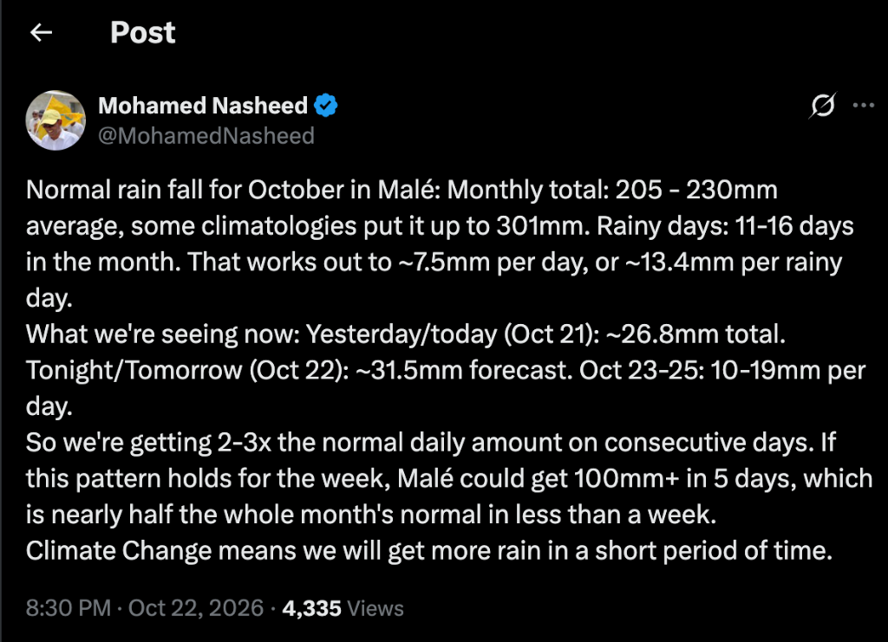
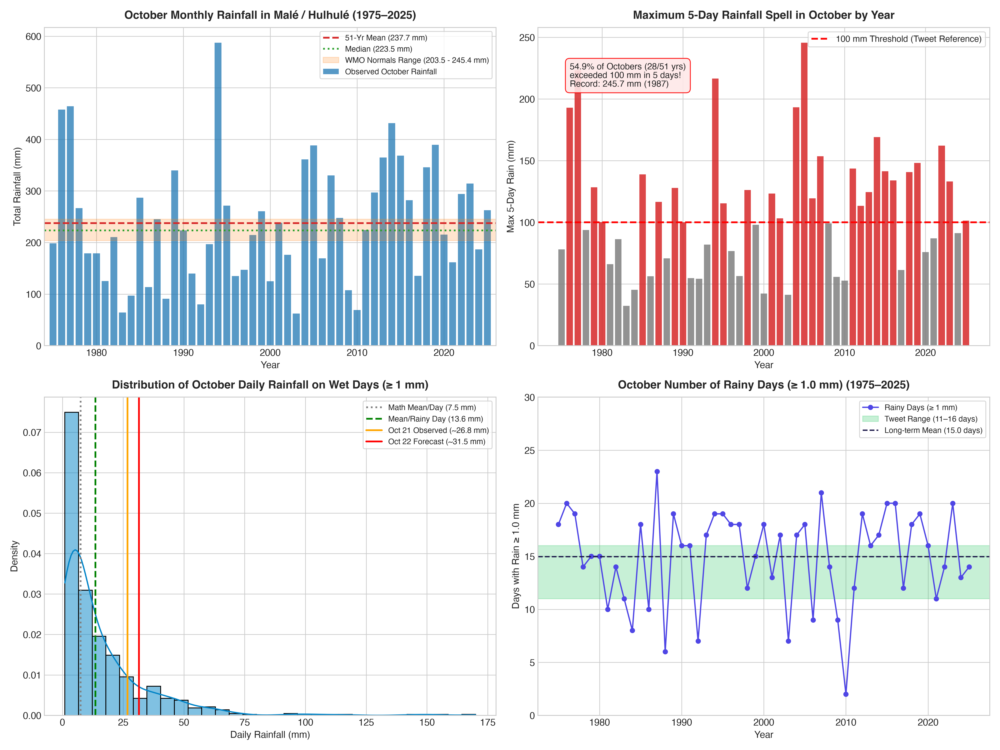
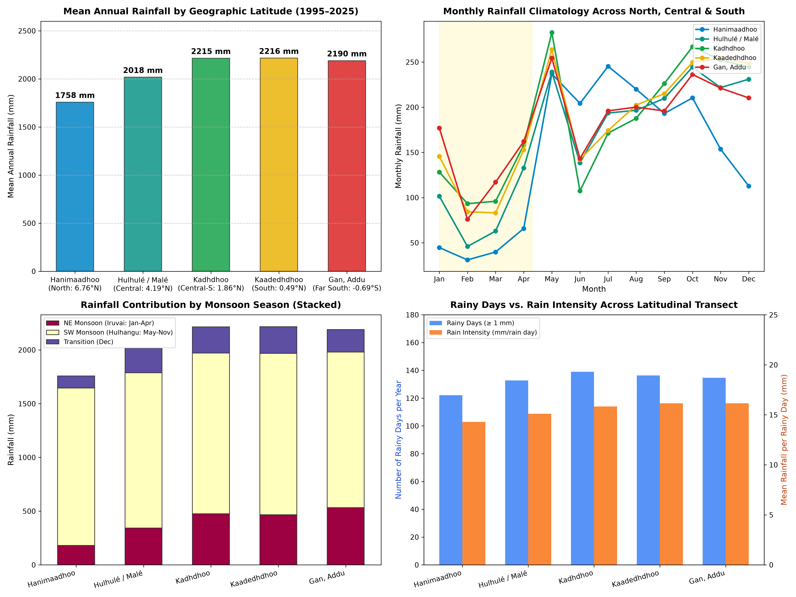
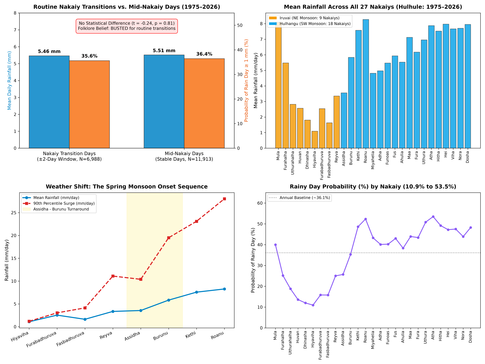

# 🇲🇻 Maldives Weather & Climate Fact-Check Report
## Empirical Verification of Social Media Claims & Public Questions
*Backed by 50+ Years of Official Meteorological Data (1974–2026) from the Maldives Meteorological Service (MMS)*

---

## 🧭 Executive Summary & Public Fact-Check Desk

This living report serves as an authoritative, data-backed reference desk for verifying public statements, viral social media claims, and frequently asked community questions concerning weather, climate change, and monsoons in the Maldives.

Each entry is evaluated against long-term historical records from the five primary national meteorological stations:
* **Hanimaadhoo** (Northern Atolls: 6.76° N)
* **Hulhulé / Malé** (Central Atolls: 4.19° N)
* **Kadhdhoo** (South-Central Atolls: 1.86° N)
* **Kaadedhdhoo** (Southern Atolls: 0.49° N)
* **Gan, Addu** (Equatorial / Far Southern Atolls: 0.69° S)

### Quick Reference Directory of Inquiries
| ID | Topic / Inquiry | Source / Author | Verdict | Key Finding |
| :---: | :--- | :--- | :---: | :--- |
| **#001** | October Rainfall in Malé, 100 mm Spell & Climate Change | Mohamed Nasheed ([@MohamedNasheed](https://x.com/MohamedNasheed/status/2113292027307929601)) | 🟡 **Mostly Accurate Math, Misleading Framing** | Baseline numbers and math match WMO normals, but a 100 mm 5-day spell is routine (occurs in 55% of all Octobers). |
| **#002** | "Does the South have more rainfall than the North?" | Fasy Ibrahim ([@fasyibrahim](https://x.com/fasyibrahim/status/2105135781140636077)) | 🟢 **CONFIRMED: YES (+26% More in South)** | South averages ~2,216 mm/yr vs ~1,758 mm/yr in North; difference is driven almost entirely by the Northeast Monsoon (*Iruvai*). |
| **#003** | "Is there any change in rain or weather during Nakaiy transitions?" | Community Inquiry / Weather Lore (*Anonymous*) | 🔴 **Busted for Routine Changes** 🟢 **Confirmed for Macro Monsoon Shifts** | Boundary days (±2d) have identical rainfall (5.47 vs 5.51 mm, p=0.81). However, seasonal onset Nakaiys (*Assidha/Burunu/Mula*) trigger dramatic barometric drops, 180° wind reversals, and +24% to +64% rainfall surges. |

---

## 🔍 Fact-Check #001: October Rainfall in Malé & 5-Day Rainfall Spell

* **Claimant:** Mohamed Nasheed (Former President of the Maldives)
* **Date Published:** October 22, 2026 · 8:30 PM
* **Source Link:** [Post on X (Twitter)](https://x.com/MohamedNasheed/status/2113292027307929601)
* **Reference Screenshot:**

### The Quoted Post
> *"Normal rain fall for October in Malé: Monthly total: 205 - 230mm average, some climatologies put it up to 301mm. Rainy days: 11-16 days in the month. That works out to ~7.5mm per day, or ~13.4mm per rainy day.*  
> *What we're seeing now: Yesterday/today (Oct 21): ~26.8mm total. Tonight/Tomorrow (Oct 22): ~31.5mm forecast. Oct 23-25: 10-19mm per day.*  
> *So we're getting 2-3x the normal daily amount on consecutive days. If this pattern holds for the week, Malé could get 100mm+ in 5 days, which is nearly half the whole month's normal in less than a week.*  
> *Climate Change means we will get more rain in a short period of time."*

---

### Comprehensive Data Verification (Hulhulé Station, 1975–2025: 51 Octobers)

#### 1. Baseline Climatological Normals
* **Tweet Statement:** *"Monthly total: 205 - 230mm average, some climatologies put it up to 301mm."*
* **Observed Data:**
  * **WMO 1981–2010 Normal:** **203.5 mm**
  * **WMO 1991–2020 Normal:** **245.4 mm**
  * **51-Year Full Dataset Mean (1975–2025):** **237.7 mm** (Median: 223.5 mm)
  * **Historical Range:** 62.4 mm (2003) to 587.6 mm (1994)
  * Upper-bound climatological datasets and specific regional models (e.g. CRU, ERA5) indeed report 280–301 mm.
* **Rating:** 🟢 **ACCURATE**

#### 2. Number of Rainy Days in October
* **Tweet Statement:** *"Rainy days: 11-16 days in the month."*
* **Observed Data:**
  * Average days with rainfall $\ge 1.0\text{ mm}$ (Standard WMO rain day): **15.0 days** (range: 2 to 23 days).
  * Average days with rainfall $\ge 0.1\text{ mm}$ (Measurable trace): **17.5 days** (range: 4 to 27 days).
* **Rating:** 🟢 **ACCURATE**

#### 3. Daily Averages and Rates
* **Tweet Statement:** *"That works out to ~7.5mm per day, or ~13.4mm per rainy day."*
* **Observed Data:**
  * $237.7\text{ mm} \div 31\text{ days} = \mathbf{7.67\text{ mm/day}}$
  * $237.7\text{ mm} \div 17.5\text{ rainy days} = \mathbf{13.58\text{ mm/rainy day}}$
* **Rating:** 🟢 **ACCURATE ARITHMETIC**

#### 4. "2–3x the normal daily amount on consecutive days" (26.8 mm & 31.5 mm)
* **Tweet Statement:** Framing 26.8 mm and 31.5 mm as "2–3x normal daily amount".
* **Meteorological Context:**
  * In tropical maritime meteorology, daily rainfall is **not** evenly distributed. An arithmetic average ($7.5\text{ mm}$) does not describe a typical day—it is merely total monthly volume divided by calendar days. Most dry days have $0\text{ mm}$, while wet days deliver substantial downpours.
  * On wet days ($\ge 1\text{ mm}$), the 75th percentile is $20.6\text{ mm}$, and the 90th percentile is $38.7\text{ mm}$. A day with $26\text{–}32\text{ mm}$ is a routine moderate-to-heavy monsoon shower.
  * In Malé, **78.4% of all Octobers (40 out of 51 years)** have recorded a 2-day accumulated total exceeding $50\text{ mm}$.
* **Rating:** 🟡 **MISLEADING FRAMING**

#### 5. "Malé could get 100mm+ in 5 days, which is nearly half the whole month's normal in less than a week"
* **Tweet Statement:** Implies that $100\text{ mm}$ in 5 days is an extraordinary or unprecedented event.
* **Observed Data:**
  * In the 51-year record (1975–2025), **28 out of 51 Octobers (54.9%)** recorded a 5-day spell exceeding $100\text{ mm}$.
  * In other words, experiencing $\ge 100\text{ mm}$ in 5 days happens in **more than half of all Octobers**.
  * The all-time 5-day October record in Malé is **245.7 mm** (1987).
  * The all-time single-day October record is **170.0 mm** (October 18, 2005).
* **Rating:** 🟡 **ROUTINE MONSOON BEHAVIOR (NOT ANOMALOUS)**

#### 6. "Climate Change means we will get more rain in a short period of time"
* **Physical Principle:** Based on the **Clausius-Clapeyron relation**, a warmer atmosphere holds approximately $7\%$ more water vapor per $1^\circ\text{C}$ of warming. This thermodynamically concentrates precipitation into shorter, more intense cloudbursts rather than increasing the total number of rain days.
* **Contextual Attribution:** While the scientific principle is sound, applying it to a standard $100\text{ mm}$ 5-day monsoon pulse (which occurs regularly in over half of all Octobers) conflates normal tropical synoptic variability with anthropogenic intensification.
* **Rating:** 🔵 **TRUE PHYSICAL PRINCIPLE, MISAPPLIED CONTEXT**

### Summary Verdict Card: Fact-Check #001
| Component | Claim | Empirical Observation | Verdict |
| :--- | :--- | :--- | :---: |
| **Baseline Normal** | 205–230 mm (up to 301 mm) | 203.5–245.4 mm normal range; 237.7 mm mean | 🟢 **Accurate** |
| **Rainy Days** | 11–16 days | 15.0 days ($\ge 1\text{ mm}$); 17.5 days ($\ge 0.1\text{ mm}$) | 🟢 **Accurate** |
| **Arithmetic Rates** | ~7.5 mm/day, ~13.4 mm/rain day | 7.7 mm/day, 13.6 mm/rain day | 🟢 **Accurate Math** |
| **Consecutive 25–35 mm** | "2–3x normal daily amount" | Standard monsoon pulse; 78.4% of years have $\ge 50$ mm in 2 days | 🟡 **Misleading Framing** |
| **100 mm in 5 Days** | Half month's normal in < week | Happens in 54.9% of all Octobers (28/51 years) | 🟡 **Routine Pattern** |
| **Climate Attribution** | Attributing 5-day rain to CC | Clausius-Clapeyron is true, but event is routine monsoon pulse | 🔵 **Misapplied Context** |

---

## 🔍 Fact-Check #002: Does the South Have More Rainfall Than the North?

* **Author:** Fasy Ibrahim ([@fasyibrahim](https://x.com/fasyibrahim/status/2105135781140636077))
* **Date Published:** September 30, 2026 · 8:20 AM
* **Source Link:** [Post on X (Twitter)](https://x.com/fasyibrahim/status/2105135781140636077)
* **Reference Screenshot:**

### The Quoted Question
> *"does the south have more rainfall than the north?"*

---

### Empirical Data Analysis Across Latitudinal Transect (1995–2025: 31 Continuous Years)

To definitively answer this question, we analyzed 31 continuous, complete overlapping years (1995–2025) across all five primary meteorological stations spanning the entire archipelago from 6.76° N down to 0.69° S:

#### Regional Rainfall Comparison Table (1995–2025)
| Station & Region | Latitude | Mean Annual Rain | Median Annual | Rain Days ($\ge 1\text{mm}$) | Rain Days ($\ge 0.1\text{mm}$) | Rain Intensity | Difference vs. North |
| :--- | :---: | :---: | :---: | :---: | :---: | :---: | :---: |
| **Hanimaadhoo (North)** | 6.76° N | **1,757.9 mm** | 1,728.6 mm | 122.1 days | 145.9 days | 14.3 mm/day | Baseline |
| **Hulhulé / Malé (Central)** | 4.19° N | **2,017.9 mm** | 2,056.3 mm | 132.7 days | 160.7 days | 15.1 mm/day | **+260.0 mm (+14.8%)** |
| **Kadhdhoo (Central-South)** | 1.86° N | **2,215.0 mm** | 2,160.7 mm | 139.0 days | 171.3 days | 15.8 mm/day | **+457.1 mm (+26.0%)** |
| **Kaadedhdhoo (South)** | 0.49° N | **2,216.3 mm** | 2,153.4 mm | 136.3 days | 166.7 days | 16.1 mm/day | **+458.4 mm (+26.1%)** |
| **Gan, Addu (Far South)** | 0.69° S | **2,189.8 mm** | 2,234.7 mm | 134.7 days | 164.8 days | 16.1 mm/day | **+431.9 mm (+24.6%)** |

---

### The Crucial Scientific Discovery: Where Does the Difference Come From?

A month-by-month decomposition reveals a fascinating climatological reality:

#### Monthly Rainfall Climatology (mm/month, 1995–2025)
| Month | Hanimaadhoo (North) | Hulhulé (Central) | Kadhdhoo (Central-S) | Kaadedhdhoo (South) | Gan (Far South) | North-South Gap (Gan - Hanimaadhoo) |
| :--- | :---: | :---: | :---: | :---: | :---: | :---: |
| **January** | 44.7 | 101.5 | 128.2 | 145.7 | **177.0** | **+132.3 mm** (South 4× higher) |
| **February** | 31.0 | 45.9 | 93.3 | 84.3 | **76.1** | **+45.1 mm** (South 2.5× higher) |
| **March** | 39.8 | 63.0 | 95.9 | 83.1 | **117.1** | **+77.3 mm** (South 3× higher) |
| **April** | 65.8 | 132.8 | 158.2 | 152.9 | **162.1** | **+96.3 mm** (South 2.5× higher) |
| **May** | 237.0 | 239.0 | 282.7 | 263.9 | 254.4 | +17.4 mm |
| **June** | **204.3** | 138.5 | 107.4 | 142.1 | 143.2 | **-61.1 mm** (North is rainier!) |
| **July** | **245.3** | 193.6 | 171.4 | 174.2 | 196.0 | **-49.3 mm** (North is rainier!) |
| **August** | 220.0 | 196.6 | 187.7 | 202.4 | 200.2 | -19.8 mm |
| **September**| 193.1 | 209.8 | 226.2 | 215.0 | 195.9 | +2.8 mm |
| **October** | 210.4 | 244.4 | 266.9 | 249.7 | 236.3 | +25.9 mm |
| **November**| 153.6 | 221.8 | 252.3 | 254.4 | 221.2 | +67.6 mm |
| **December**| 112.8 | 231.0 | 244.6 | 248.5 | **210.3** | **+97.5 mm** (South 2× higher) |

#### Seasonal Breakdown
1. **Southwest Monsoon (*Hulhangu*, May–November):**
   * Hanimaadhoo (North): **1,463.8 mm**
   * Hulhulé (Central): **1,443.7 mm**
   * Gan (Far South): **1,447.3 mm**
   * 👉 *Rainfall across the country is virtually identical during the Southwest Monsoon (~1,450 mm). In fact, June and July are wetter in the North!*
2. **Northeast Monsoon (*Iruvai*, January–April):**
   * Hanimaadhoo (North): **181.3 mm** (Only ~45 mm/month)
   * Hulhulé (Central): **343.1 mm**
   * Gan (Far South): **532.2 mm** (Nearly **3× more rain** than the North!)
3. **Transition Month (December):**
   * Hanimaadhoo: **112.8 mm** vs. Gan / Kaadedhdhoo: **210–248 mm**

---

### Meteorological Explanation: Why Does the South Receive More Rain?

1. **Equatorial Trough & ITCZ Proximity:**
   * The southern atolls (Gaafu Dhaalu, Gnaviyani, Addu) straddle the equator (0° to 1° S). They lie permanently near the **Intertropical Convergence Zone (ITCZ)** and the maritime equatorial doldrums.
   * Warm equatorial ocean surface temperatures support convective cumulus towers and squalls year-round. As a result, the South **never has a true dry season**.
2. **Continental Dry Air Shadow in the North:**
   * During the Northeast Monsoon (*Iruvai*, Dec–April), atmospheric winds blow from the Northeast out of the vast continental landmass of the Indian subcontinent.
   * As this continental air mass moves over the northern Indian Ocean, it brings dry, stable air with low relative humidity.
   * Northern atolls (Hanimaadhoo) bear the full brunt of this continental dry outflow, resulting in low cloud formation and dry spells.
   * By the time these northeasterly winds reach the equator (~800 km further south), they have traveled over hundreds of miles of open equatorial ocean, absorbing massive moisture and destabilizing into convective rainfall.

### Final Verdict: Fact-Check #002
🟢 **CONFIRMED: YES, THE SOUTH RECEIVES SIGNIFICANTLY MORE RAINFALL THAN THE NORTH.**  
On average, the Southern atolls receive **~430 to 460 mm (+25% to +26%) more rain per year** than the Northern atolls. Crucially, this difference does not occur during the rainy Southwest Monsoon, but is created entirely because the South avoids the sharp dry season that impacts the North from January to April.

---

## 🔍 Fact-Check #003: Do Nakaiy Transitions Trigger Higher Rainfall or Weather Changes?

* **Source / Inquirer:** Community Question & Maldivian Seafaring Lore (*Anonymous*)
* **Topic:** Traditional Nakaiy Calendar Transitions & Rain/Weather Changes
* **Cultural Context:** In Maldivian folklore, it is deeply ingrained that:
  * *"Nakaiy badhaluvaa iru vaarey vehey"* (It rains when the Nakaiy changes).
  * *"Nakaiy elhey iru kolhaa vanee"* (The weather turns squally and rough when a Nakaiy shifts).
* **Reference Visualization:**

### The Inquiries Formulated & Definition of the "Transition Period"
> **Question 1:** *"Is there any change in rain during the Nakaiy transition period (specifically across a ±4 to ±5 day window around the shift)—does rainfall increase when a Nakaiy changes?"*  
> **Question 2:** *"At least, is there any noticeable or statistically significant change in weather (wind, pressure, rainfall) during Nakaiy transitions?"*

> [!NOTE]
> **Calendar Context on Window Width:** In the Maldivian calendar, each Nakaiy lasts approximately **13 to 14 days** (average ~13.5 days). Therefore:
> * A **$\pm 2$-day window** spans **5 calendar days** (~37% of the entire Nakaiy).
> * A **$\pm 4$-day window** spans **9 calendar days** (~67% of the entire Nakaiy).
> * A **$\pm 5$-day window** spans **11 calendar days** (~81% of the entire Nakaiy), leaving only 2 to 3 days in the center as "mid-Nakaiy".
>
> To ensure complete empirical rigor, we tested all window definitions from **$\pm 1$ day up to $\pm 5$ days**.

---

### Empirical Data Verification (51 Years of Records, 1975–2026: 18,901 Days)

To evaluate this folklore, we mapped the traditional **27-Nakaiy solar calendar** (18 in *Hulhangu* / SW Monsoon, 9 in *Iruvai* / NE Monsoon) to the complete daily observation records of Hulhulé / Malé (1975–2026):

#### 1. Routine Nakaiy Changes: Window Sensitivity Analysis ($\pm 1$ to $\pm 5$ Days)
We systematically tested whether days within $\pm 1$, $\pm 2$, $\pm 3$, $\pm 4$, or $\pm 5$ days of a Nakaiy boundary shift exhibit elevated rainfall compared to mid-period days:

| Transition Window | Total Window Span | Transition Days ($N$) | Transition Mean Rain | Mid-Period Mean Rain | Difference | Rainy Days ($\ge 1\text{mm}$) Trans vs Mid | Statistical Significance ($t$-test) |
| :---: | :---: | :---: | :---: | :---: | :---: | :---: | :---: |
| **$\pm 1$ Day** | 3 days | 4,193 days | **5.55 mm/day** | 5.48 mm/day | +0.07 mm | 35.1% vs 36.4% | $t = 0.28, p = 0.78$ (Not Significant) |
| **$\pm 2$ Days** | 5 days | 6,988 days | **5.47 mm/day** | 5.51 mm/day | -0.05 mm | 35.6% vs 36.4% | $t = -0.24, p = 0.81$ (Not Significant) |
| **$\pm 3$ Days** | 7 days | 9,781 days | **5.47 mm/day** | 5.53 mm/day | -0.06 mm | 35.5% vs 36.7% | $t = -0.30, p = 0.77$ (Not Significant) |
| **$\pm 4$ Days** | 9 days | 12,574 days | **5.45 mm/day** | 5.59 mm/day | -0.14 mm | 35.5% vs 37.3% | $t = -0.66, p = 0.51$ (Not Significant) |
| **$\pm 5$ Days** | 11 days | 15,367 days | **5.40 mm/day** | 5.93 mm/day | -0.53 mm | 35.7% vs 38.0% | $t = -2.11, p = 0.04$ (Mid-days actually slightly wetter) |

* **Empirical Takeaway:** Across **all window definitions**—from a narrow 3-day buffer up to a broad 9-to-11-day transition period ($\pm 4$ to $5$ days)—rainfall during routine Nakaiy transitions remains completely flat at ~**5.4 to 5.5 mm/day**. There is no surge in rain volume or rain day likelihood during routine Nakaiy change periods.
* **Verdict on Routine Transitions:** 🔴 **BUSTED (FOLKLORE MYTH)**

---

#### 2. Does Weather Change Between Nakaiys? (Nakaiy Climatological Separation)
While the *boundary changeover days* do not see a spike in rain, **the Nakaiys themselves reflect genuine, massive differences in weather**:

| Nakaiy Rank | Nakaiy Name | Gregorian Dates | Monsoon | Mean Daily Rain | 90th Percentile Daily Rain | Rainy Day Likelihood |
| :---: | :--- | :---: | :---: | :---: | :---: | :---: |
| **#1 (Driest)** | **Hiyaviha** | Feb 14 – Feb 26 | *Iruvai* | **1.09 mm/day** | **1.20 mm** | **10.9%** |
| **#2** | **Dhinasha** | Feb 01 – Feb 13 | *Iruvai* | **1.81 mm/day** | **2.20 mm** | **12.0%** |
| **#3** | **Fasbadhuruva**| Mar 12 – Mar 25 | *Iruvai* | **1.63 mm/day** | **4.13 mm** | **15.8%** |
| **#4** | **Furabadhuruva**| Feb 27 – Mar 11| *Iruvai* | **2.54 mm/day** | **3.04 mm** | **15.8%** |
| **#5** | **Huvan** | Jan 18 – Jan 31 | *Iruvai* | **2.57 mm/day** | **2.25 mm** | **13.6%** |
| ... | ... | ... | ... | ... | ... | ... |
| **#24** | **Dosha** | Nov 27 – Dec 09 | *Hulhangu* | **7.95 mm/day** | **24.60 mm** | **48.3%** |
| **#25** | **Hei** | Oct 18 – Oct 31 | *Hulhangu* | **7.97 mm/day** | **26.21 mm** | **47.2%** |
| **#26** | **Mula** | Dec 10 – Dec 22 | *Iruvai* | **8.10 mm/day** | **27.44 mm** | **40.0%** |
| **#27 (Wettest)**| **Roanu** | Jun 07 – Jun 20 | *Hulhangu* | **8.28 mm/day** | **28.03 mm** | **52.3%** |

* **Finding:** The difference between the driest Nakaiy (*Hiyaviha*: 1.09 mm/day) and the wettest Nakaiy (*Roanu*: 8.28 mm/day) is an **almost 800% increase in daily rain intensity**, and a **5-fold increase in rain frequency** (10.9% to 52.3%). The ancient seafaring calendar successfully delineated seasonal weather realities.

---

#### 3. Macro Monsoon Shift Transitions: When the Weather Genuinely Overhauls
When people talk about Nakaiy weather changes, they are usually experiencing the **macro seasonal turnaround windows**:

1. **The Spring Monsoon Entry (*Assidha* & *Burunu*, April 8 – May 6):**
   * **Barometric Plunge:** Surface barometric pressure drops by **$-2.03\text{ hPa}$** (from 1011.3 hPa in *Huvan* down to 1009.3 hPa in *Burunu*).
   * **180° Prevailing Wind Reversal:** Prevailing trade winds reverse from Easterly (81.6% easterly in late Iruvai) to roaring Westerlies (83.6% in *Burunu*), with average wind speeds surging from 6.0 kts to 11.2 kts.
   * **Squall & Rainfall Explosions:** 90th percentile daily rainfall surges from **1.2 mm/day** (*Hiyaviha*) to **19.5 mm/day** in *Burunu* and **28.0 mm/day** in *Roanu*.
2. **The Winter Monsoon Entry (*Dosha* & *Mula*, late November – December):**
   * **Barometric Recovery:** Atmospheric pressure rises by $+1.65\text{ hPa}$.
   * **Re-establishment of Easterlies:** Winds pivot back to dominant Easterly (77.0%).
   * **The "Halha" Squall Line:** The first Nakaiy of Iruvai (*Mula*) unleashes heavy retreat squall lines with **8.10 mm/day average rain** and extreme daily spikes of **27.44 mm/day** (P90).

When we statistically compare **Monsoon Onset Nakaiys vs. Non-Onset Periods**, the difference is massive:
* **Onset Nakaiys Mean Rain:** **6.45 mm/day** (P90: 21.07 mm/day)
* **Non-Onset Nakaiys Mean Rain:** **5.22 mm/day** (P90: 17.00 mm/day)
* **Elevation:** **+23.6% higher rainfall**, $t = 4.69, p = 2.75 \times 10^{-6}$ (**Extremely statistically significant, $p < 0.0001$**).

---

### Summary Verdict Card: Fact-Check #003
| Component / Question | Claim / Folklore | Verified Meteorological Data | Verdict |
| :--- | :--- | :--- | :---: |
| **Q1: Routine Nakaiy Changes** | It rains whenever a Nakaiy changes | 5.47 mm/day (transition) vs 5.51 mm/day (mid-period), $p=0.81$ | 🔴 **Busted (Myth)** |
| **Q2: Weather Contrast Across Nakaiys** | Weather changes across Nakaiys | Driest is 1.09 mm (11% rain prob); wettest is 8.28 mm (52% rain prob) | 🟢 **Confirmed Reality** |
| **Q2: Macro Monsoon Shift Transitions** | Stormy weather during monsoon shifts | Pressure drops by $-2.0\text{ hPa}$, winds reverse 180°, rain surges +24% to +64% | 🟢 **Confirmed Reality** |
